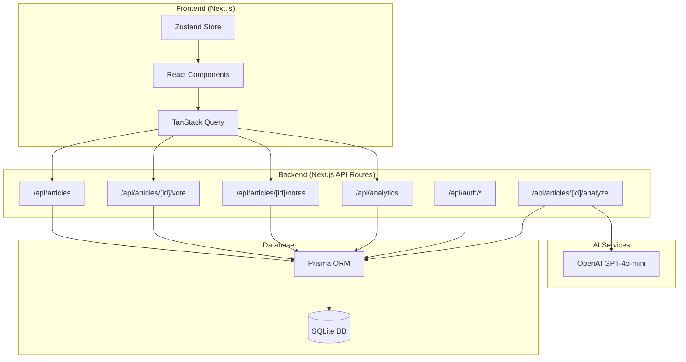
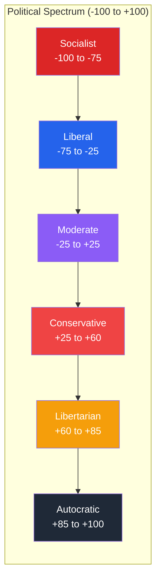
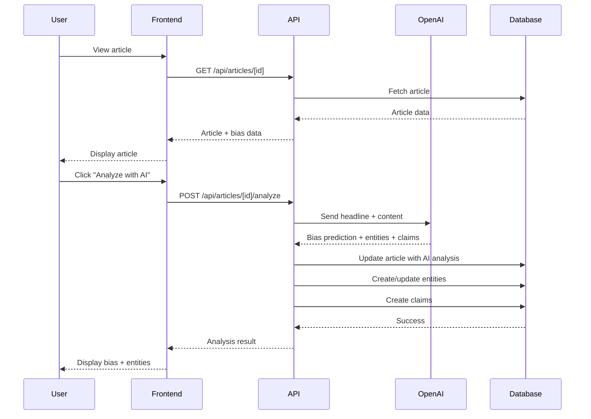
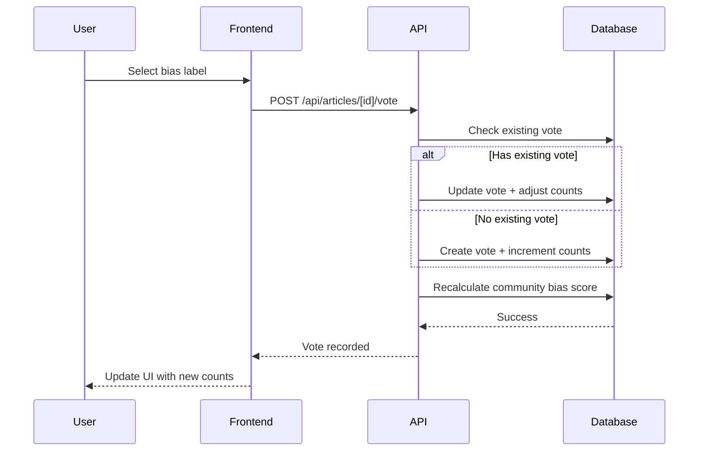
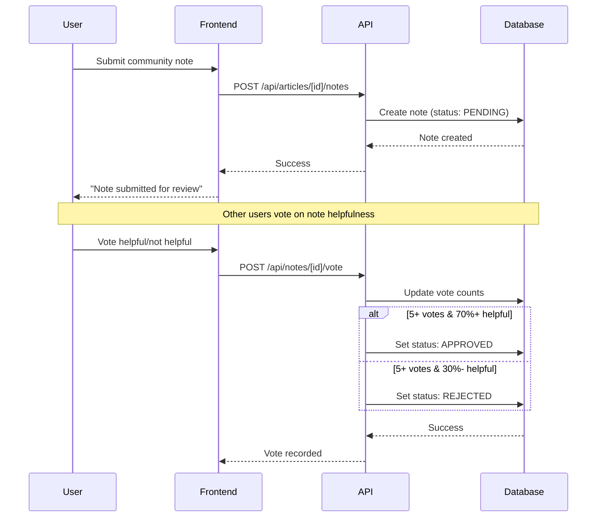
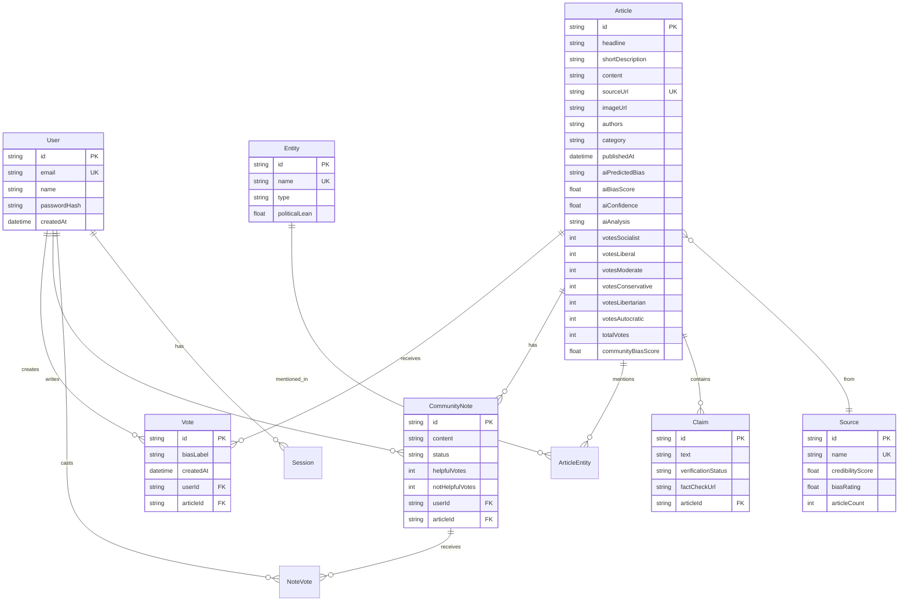
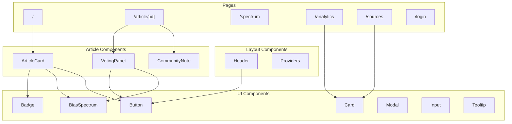
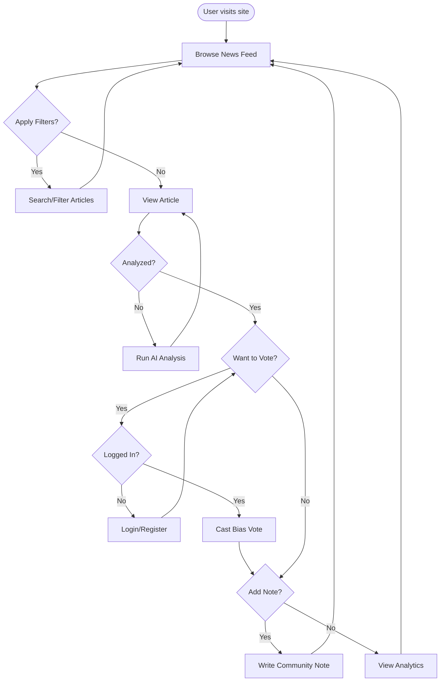

# Hearsay - Transparent News Bias Detection Platform

A modern, AI-powered platform for detecting and crowdsourcing political bias in news articles. Inspired by Twitter/X's Community Notes feature, Hearsay combines OpenAI's GPT models with community voting to create a transparent news ecosystem.

## Overview

Hearsay aims to increase media literacy by making political bias visible and transparent. Users can:
- See AI-predicted political bias for news articles
- Vote on perceived bias using a political spectrum
- Add community notes to provide context
- View analytics on bias distribution across sources
- Track credibility scores for news outlets

---

## Architecture



---

## Political Spectrum

Hearsay uses a 6-point political spectrum for bias classification:



| Label | Score Range | Description |
|-------|-------------|-------------|
| Socialist | -100 to -75 | Far-left ideology emphasizing collective ownership |
| Liberal | -75 to -25 | Center-left supporting social progress and government programs |
| Moderate | -25 to +25 | Centrist position balancing different viewpoints |
| Conservative | +25 to +60 | Center-right emphasizing tradition and limited government |
| Libertarian | +60 to +85 | Emphasizing individual liberty and minimal government |
| Autocratic | +85 to +100 | Far-right authoritarian ideology |

---

## Data Flow

### Article Analysis Flow



### Voting Flow



### Community Notes Flow



---

## Database Schema



---

## Tech Stack

| Layer | Technology |
|-------|------------|
| **Framework** | Next.js 14 (App Router) |
| **Language** | TypeScript |
| **Styling** | Tailwind CSS v4 |
| **Database** | SQLite (via Prisma) |
| **ORM** | Prisma 5 |
| **AI** | OpenAI GPT-4o-mini |
| **State Management** | Zustand |
| **Data Fetching** | TanStack Query |
| **Animations** | Framer Motion |
| **Charts** | Recharts |
| **Icons** | Lucide React |
| **Auth** | Custom (bcrypt) |
| **Notifications** | React Hot Toast |

---

## Features

### Core Features
- **News Feed**: Browse political news articles with bias indicators
- **AI Bias Analysis**: OpenAI-powered political bias detection
- **Community Voting**: Crowdsourced bias classification
- **Political Spectrum Visualization**: Interactive bias spectrum display
- **Community Notes**: Twitter/X-style context additions
- **Entity Extraction**: Automatic detection of politicians, parties, states, organizations
- **Claim Detection**: Identification of verifiable claims

### Analytics & Insights
- **Platform Analytics**: Overall bias distribution charts
- **Source Credibility Scores**: Track reliability of news outlets
- **Vote Distribution**: See how the community rates each article
- **Trend Analysis**: Bias patterns over time

### User Features
- **User Authentication**: Register/login system
- **Personal Voting History**: Track your voting patterns
- **Dark Mode**: Full dark theme support
- **Responsive Design**: Works on mobile, tablet, desktop

---

## Screenshots

### Home Feed
The main feed shows articles with AI-predicted bias badges, community voting counts, and quick-vote buttons.

### Article Detail
Detailed view with bias spectrum visualization, entity tags, community notes, and verifiable claims.

### Spectrum View
All articles organized by political lean, from Socialist to Autocratic.

### Analytics Dashboard
Platform-wide bias distribution charts and top entity/source rankings.

---

## Getting Started

### Prerequisites

- Node.js 18+
- npm or yarn
- OpenAI API key

### Installation

1. **Clone the repository**
   ```bash
   git clone https://github.com/yourusername/hearsay.git
   cd hearsay
   ```

2. **Install dependencies**
   ```bash
   npm install
   ```

3. **Set up environment variables**
   ```bash
   # Edit .env and add your OpenAI API key
   OPENAI_API_KEY="your-openai-api-key-here"
   NEXTAUTH_SECRET="your-secret-here"
   NEXTAUTH_URL="http://localhost:3000"
   ```

4. **Initialize the database**
   ```bash
   # Run migrations
   npx prisma migrate dev

   # Seed with sample data
   npm run seed
   ```

5. **Start the development server**
   ```bash
   npm run dev
   ```

6. **Open the app**

   Navigate to [http://localhost:3000](http://localhost:3000)

### Demo Account

Use the pre-seeded demo account to test:
- **Email**: demo@hearsay.ai
- **Password**: demo123

---

## Project Structure

```
hearsay/
├── prisma/
│   ├── schema.prisma      # Database schema
│   ├── seed.ts            # Sample data seeder
│   └── migrations/        # Database migrations
├── src/
│   ├── app/               # Next.js App Router pages
│   │   ├── api/           # API routes
│   │   │   ├── articles/  # Article CRUD & voting
│   │   │   ├── auth/      # Authentication
│   │   │   ├── analytics/ # Platform analytics
│   │   │   ├── notes/     # Community notes voting
│   │   │   └── sources/   # News sources
│   │   ├── article/       # Article detail page
│   │   ├── analytics/     # Analytics dashboard
│   │   ├── login/         # Auth pages
│   │   ├── sources/       # Source credibility page
│   │   ├── spectrum/      # Spectrum visualization
│   │   ├── layout.tsx     # Root layout
│   │   └── page.tsx       # Home/feed page
│   ├── components/
│   │   ├── article/       # Article-related components
│   │   ├── layout/        # Layout components (header)
│   │   └── ui/            # Reusable UI components
│   ├── lib/
│   │   ├── openai.ts      # OpenAI API integration
│   │   ├── prisma.ts      # Prisma client
│   │   └── utils.ts       # Utility functions
│   ├── store/
│   │   └── index.ts       # Zustand store
│   └── types/
│       └── index.ts       # TypeScript types
├── .env                   # Environment variables
├── package.json
└── README.md
```

---

## API Reference

### Articles

| Method | Endpoint | Description |
|--------|----------|-------------|
| GET | `/api/articles` | List articles (with pagination, filters) |
| POST | `/api/articles` | Create new article |
| GET | `/api/articles/[id]` | Get article details |
| POST | `/api/articles/[id]/vote` | Vote on article bias |
| POST | `/api/articles/[id]/analyze` | Run AI bias analysis |
| GET | `/api/articles/[id]/notes` | Get community notes |
| POST | `/api/articles/[id]/notes` | Add community note |

### Query Parameters for GET /api/articles

| Parameter | Type | Description |
|-----------|------|-------------|
| `page` | number | Page number (default: 1) |
| `limit` | number | Items per page (default: 20) |
| `category` | string | Filter by category |
| `bias` | string | Filter by AI bias prediction |
| `source` | string | Filter by source ID |
| `search` | string | Search in headline/description |

### Authentication

| Method | Endpoint | Description |
|--------|----------|-------------|
| POST | `/api/auth/register` | Create new account |
| POST | `/api/auth/login` | Login |

### Other

| Method | Endpoint | Description |
|--------|----------|-------------|
| GET | `/api/analytics` | Platform statistics |
| GET | `/api/sources` | List news sources |
| POST | `/api/notes/[id]/vote` | Vote on community note |

---

## AI Integration

Hearsay uses OpenAI's GPT-4o-mini model for:

1. **Bias Classification**: Predicts political lean on 6-point scale
2. **Confidence Scoring**: 0-100% confidence in prediction
3. **Analysis Explanation**: Natural language explanation of detected bias
4. **Entity Extraction**: Identifies politicians, parties, states, organizations
5. **Claim Detection**: Extracts verifiable factual claims

### Sample AI Response

```json
{
  "predictedBias": "LIBERAL",
  "biasScore": -45,
  "confidence": 78,
  "analysis": "The article uses language favorable to environmental regulations...",
  "entities": [
    { "name": "Joe Biden", "type": "POLITICIAN", "sentiment": "POSITIVE" },
    { "name": "Democratic Party", "type": "PARTY", "sentiment": "POSITIVE" }
  ],
  "claims": [
    { "text": "Carbon emissions dropped 15% last year", "verifiable": true }
  ]
}
```

---

## Component Architecture



---

## User Flow



---

## Scripts

| Command | Description |
|---------|-------------|
| `npm run dev` | Start development server |
| `npm run build` | Build for production |
| `npm run start` | Start production server |
| `npm run seed` | Seed database with sample data |
| `npm run db:push` | Push schema changes to DB |
| `npm run db:studio` | Open Prisma Studio GUI |
| `npm run db:reset` | Reset DB and re-seed |

---

## Environment Variables

| Variable | Description | Required |
|----------|-------------|----------|
| `DATABASE_URL` | SQLite connection string | Yes |
| `OPENAI_API_KEY` | OpenAI API key for bias analysis | Yes |
| `NEXTAUTH_SECRET` | Secret for session encryption | Yes |
| `NEXTAUTH_URL` | Base URL of the application | Yes |

---

## Contributing

1. Fork the repository
2. Create a feature branch (`git checkout -b feature/amazing-feature`)
3. Commit changes (`git commit -m 'Add amazing feature'`)
4. Push to branch (`git push origin feature/amazing-feature`)
5. Open a Pull Request

---

## Future Enhancements

- [ ] Real-time news aggregation from RSS feeds
- [ ] Browser extension for bias detection on any page
- [ ] Multi-language support
- [ ] User reputation system
- [ ] Fact-check API integrations (Snopes, PolitiFact)
- [ ] Social sharing with bias context
- [ ] Email digest of bias trends
- [ ] Export voting data for research
- [ ] Mobile app (React Native)
- [ ] Webhook notifications

---

## Inspiration

This project was inspired by:
- **Twitter/X Community Notes**: Crowdsourced context on tweets
- **AllSides Media Bias Ratings**: Media bias classification
- **Ground News**: Multi-source news coverage comparison
- The original Hearsay academic project by Ananth Narasimhan & Sudhanva Narayana

---

## License

MIT License - see [LICENSE](LICENSE) for details.

---

## Authors

- **Sudhanva Narayana** - [GitHub](https://github.com/sudhanva)
- **Ananth Narasimhan** - Original concept co-author

---

Built with Next.js, OpenAI, and community power.
